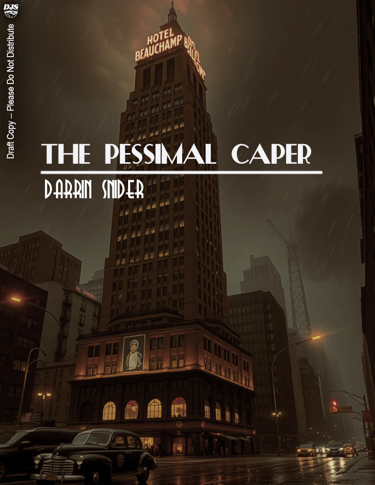

# The Pessimal Caper

This is the accuntability copy of a speed-drafted manuscript written for NaNoWriMo 2026.  It was written over the course of 30 days from an original idea, with very few edits or revisions in the spirit of the contest. It is presented here to show what happens when write for quantity of words with no regard for whether they are actually **good** or not.  Please only read it if you are familiar with these situations and understand it's a "zeroth draft" full of padding, improvising, and whatever it takes to get enough words on a page to call it a novel.  Don't assume I am always this bad of a writer.  Just enjoy the suck as much as I enjoyed writing the suck.

The story is based on [a dream I had in 2008](https://perichore.com/2008/04/14/ready-for-nanowrimo/), before I'd ever tried NaNoWriMo, but it went on my bucket list.  It has evolved from a bizarre, surreal dream to a loving hommage to my favorite '30s/early '40s radio, film, and media. Fans of the era will spot tropes, running gags, and characters based loosely on Philip Marlowe, Abbot and Costello, the Marx Brothers, Burns and Allen, The Great Gildersleeve, Henry Aldridge, The Shadow, and a few overt references to Jack Benny, Nancy Drew, and the classic Universal Horror films.

Just as Pessimal Design is my satrical comedy; Pessimal Refrain is abusurdist comedy; and Pessimal Hero is dark comedy, Pessimal Caper is its own genre as well.  Structurally, the comedy style is also meant to mimic the farce movie/stage play of the 30s and 40s. Act 1 reads like a Bugsby Berkeley produced Philip Marlowe -- serious scenes intercut with comedic interludes -- I would have included a musical number if I knew how.  Nothing really supernatural or absurd happens until Act 2, when things begin their classic "escalation."  Act 3 is where the story goes off the rails as multiple subplots begin to converge (I hope).  At the time of this writing, I have intentionally only outlined the first two acts, and plan to figure out the third when I get there.
