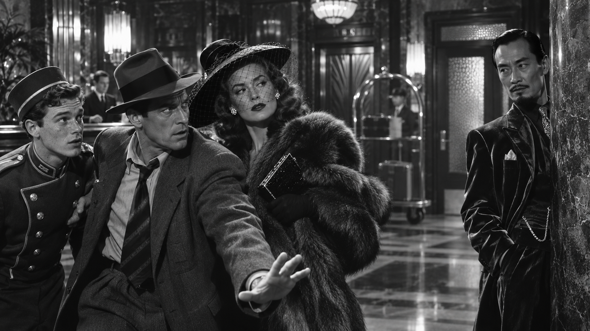

# Luk See

The overworked bellhop was just ending his Thursday shift, not realizing he was a little over twelve hours away from the longest two days of his life, as well as his own coming out into manhood. Basically, the whole hotel was starting to fill up with unsatiated hormones. Fortunately, at my age, I was immune. Not to mention, one helpless redhead as a client was already pushing my professional limits.

I took a liking to the kid instantly. It felt like he was always three places at once--emtying cigar butts from an oversized ashtray, straightening a potten palm that never looks quite upright, and then, miraculously, back at the concierge stand whenever someone approaced.

When I saw the pretty young debutante with the veiled hat and modest mountain of luggage sidle up, I instantly knew he was in trouble. She wore a tailored navy traveling suit that somehow looked simultaneously proper and dangerous. Her hat was tilted perfectly over dark curls to hide the sinister nature her left eye betrayed. Her gloved hands rested on the luggage like they were pets who would go ferral if she lifted them.

“Afternoon, miss,” I heard the kid say as he took the room key with one hand and began loading her cases on his cart with the other. “I’ll just get these up to your room for you. Number 412, was it?”

The girl’s eyes moved over him slowly, taking in the slight flush on his cheeks and the careful way he avoided looking anywhere near her décolletage. She smiled in a way that any other man would call innocent, but I knew instantly it was predatory.

“How thoughtful.” She smiled innocently. “You look like a boy who knows how to handle... heavy things.”

The kid blinked and tested the first suitcase. “These aren’t so bad, miss. I’ve carried worse. Last month, we had an encyclopedia salesman come through with a trunk full of book. That one nearly put by back out.”

“Ooh, encyclopedias,” she repeated. “Educational. Tell me, do you take the same good care of a lady’s... belongings?”

He straightened with pride. “Yes, ma’am. I never drop a bag or scratch the leather. It's important to make sure everything arrives safe and sound.”

The girl stepped right into his unintended opening. I'd seen the trick. She was showing off the potency of her perfume---no doubt something expensive and faintly wicked. “Safe and sound,” she repeated. “I love a man man who understands the importance of... careful handling almost as much as I love a man in uniform." Her finger traced the fake braidings on his sleeve. Again, the kid didn't notice. "Most boys are so rough. They just push things around without any regard for how delicate they might be.”

The kid nodded vigorously and earnestly. “Oh, I know exactly what you mean. Last week, I watched Eugene, the night shift bellboy, just throw a lady’s hatbox on the cart and caved in the side. Lost big tip because of it. Now, me? I always use both hands and make sure to keep everything level.”

She tilted her head like a cat staring at a particularly clueless goldfish in a bowl. “Keep it level. Both hands. Oh, you do do know just what to say to a girl, don't you?” She ran her finger over the handle of the vanity case. “Now, this little one here is very important. It contains all of my most personal, private things. I simply can't have anything in it being, you know, disturbed.”

The kid instantly snapped to attention at what he considered a challenge. “If it's important to you, then I'll carry it in my free hand and not even put it on the cart. That way I can make sure it stays upright the entire way.”

“Upright,” she said softly, as though tasting the word. “That would be perfect. I do like things to remain... upright. At least until I’m ready for them not to be.”

He nodded, grabbed the vanity case, and tilted his head like a dog listening to an odd noise. “Until you’re ready...?" The wrong realization dawned on him. "Oh, yeah, you mean once you're ready to unpack. Don't worry. I'll make sure everything is in a secure spot so you can get to it whenever you're ready.”

She started to sway on her feet a little. “Whenever I'm ready,” she repeated. “That sounds so lovely.” She reached up and straightened the braid on his shoulder. “You know, I could get used to this kind of attentive service. Most young men these days are so impatient. They rush. They don’t take the time to properly attend to a lady’s needs.”

The kid grinned and nodded in agreement. “Very true. Mr. Weatherby always says, ‘If you’re going to do a job, do it right. Don’t leave anything half-done.”

“Precisely,” she agreed. Her voice dropped just a fraction. “You should always finish what you start.”

For a minute there, I though she had actually shattered the poor kid's pride. "Yes, miss. I do. I would never leave a job half-done."

Her eyes practically glazed over at that, and when she stepped back to let him put the first case on the cart it may have been unintentional. She began fanning herself. "Oh, I do hope you're not boasting," she said. "I have a felling this job might take... longer than usual."

The kids was already halfway to the elevator and didn't hear any of that. “Don’t worry, miss!" he called back, "I’ve got strong arms and nowhere else to be. I’ll get every last one of these up there safe. You just leave everything to me.”

The girl watched him go, one gloved hand resting against her lips to hide the soft, delighted laugh that threatened to escape. “Oh,” she murmured to the empty lobby air. “I fully intend to.”

The lobby crowd was thinner and sweatier than I expected for 5 PM, which was definitely to my advantage. I circled the lobby twice, casing the joint. No sign of Hotel Detective Alastair Pierce. I considered that a small victory. There was also no sign of any known criminals, fences, or jewel thieves, which, I must admit, worried me a bit.

“You look worried, Mr. Chase,” said a slinky contralto that I recognized instantly.

“I never worry.”

“My mistake then.”

I turned and saw Peyton Halston-Kensington leaning against a large column, no doubt keeping the ceiling from coming down on us, and nonchalantly chewed her right thumbnail while tucking her left hand under her elbow. Then she reached over and pretended to remove a speck of lint from my coat's shoulder and straighten a wrinkle that I was pretty sure didn’t exist. “I trust everything went well with my niece and brother-in-law today?”

“Just fine. They’re nice people. It would be a shame if her perfect weekend were ruined by something as petty as a jewelry theft. By the way, I thought we were keeping our distance in public. Something about ‘you don’t know me?’”

“I know, but the other families don’t arrive until tomorrow, and I just had to see you.” She batted her eyes. Suddenly she was the organ grinder, and I was a wind-up chimp bashing cymbals. “I trust Charles confirmed the jewels are in the hotel safe.”

“As of early this afternoon, yes.”

“Any idea how the thief is going to get to them?”

“I’m working that one out. Just missing a few details. Give me five more minutes.” I looked around for someone in charge. At the concierge desk, the over-eager, over-efficient bellhop had returned. I overheard an exasperated clerk arguing with him as a line of a couple dozen people was lining up to check in.

“I’m telling you: Yu and Mei cannot be on the same floor together? There’s too much bad blood between them,” the bellhop was calmly explaining.

“Reg, what are you talking about?!" the clerk protested. "I’ve always been good to you. I don’t know anything about bad blood between you and me.”

“Not you and me! Yu and Mei.” He stabbed a finger into the guest register and tapped the current page.

“Why don't we go get a drink after work or something and settle this? Honestly, Reg, I don't know where you get these ideas. I certainly don't have anything against you.”

“Maybe you don't, but I still say it’s best if you move Mei to a different floor.”

“Different floor?! I don’t know how to break it to you, but you’re a bellhop. Pretty much every floor in this place is responsibility.”

“Fine, I’ll take responsibility. Just move Mei to the fifth floor.”

“Who’s on the fifth floor?”

“Yes, but he doesn’t have any issues with Mei. As far as I know, they haven’t even met.”

“Who?”

“Exactly.”

“Finally, someone competent,” I said, stepping between them and locking eyes with the bellhop. “You seem to be a smart guy who's on top of everything going on around here.”

Relieved to be currently out of the conversation, the clerk turned his attention to the next couple in line. The bellhop side-eyed me, then said, “Name's Reggie O’Grady. What can I do for you?”

I lowered my voice conspiratorially. “Jack Chase,” I said. “I’m a private dick working a case and need some information.”

“I’m your man then,” he said, holding a palm up between us.

I reached into my pocket and took out my billfold. “You got change for a saw buck, Reggie?”

“Yes, sir, I do,” he said excitedly, and pulled out his own wallet.

“Well, good,” I said, putting my wallet back in my pocket. “If you’ve got that kind of cash on you, then the quarter I was about to give would have been a big insult. I don’t want to insult you, Reggie. I just have a few questions about the hotel safe.”

Reggie was still processing this but nodded for me to ask my questions.

“What’s the make and model?”

“It’s a Ratner 2610.”

“Where is it?”

“The manager, Mr. Weatherby’s office, under his desk.”

“Who has a key to the office?”

“Just Mr. Weatherby and Mr. Carson, the night manager.”

“I bet the door has a cheesy lock, though.”

“Oh yeah, any shlub with a hairpin could pick it.”

“Who has the combination to the safe?”

“Just Weatherby, Carson, and the hotel detective, Mr. Pierce.”

“... and if I had $50 bucks?”

He smiled. “... plus you.”

“Is Pierce still losing with the ponies these days?”

“He’s down $65 this week; $117.50 for the month.”

“What’s with the unusually large percentage of East Asian names in the hotel registry this weekend?”

“There’s a convention of East Asian industrialists in our third-floor banquet hall.”

“Sounds like I need to stay out of that.”

“Yeah, I don’t ask questions. I just answer them.”

“You know everyone checking into this hotel?”

“Just about. If they’ve got bags, I probably took them up to their room for them.”

“Who’s the guy on the couch in the red jacket?”

“That’s Frank ‘Slugger’ Slattery. Retired baseball player. Second baseman for Weaver Bay from ’28 to ‘32.”

“What was his batting average?”

“Lifetime .263 in 1025 at-bats, 125 runs, 88 RBI, and 8 stolen bases.”

“You’ll do,” I said, extracted a fiver from my wallet, and handed it to him. “Seen any suspicious people around lately? Criminals? Gangsters? Gunsels?”

“No, sir,” the kid said, vanishing the bill under his hat. “You suspect there’s going to be trouble?”

“No, but the dame does.” I motioned for Peyton to join us. “This is Reggie. I’ve decided he’ll be my eyes and ears. If you see anything suspicious, then tell him, and he’ll tell me.” I turned back to Reggie and held up a finger. “Only ... if it’s important, though.”

“Yes, sir.”

“The goods are in the safe. The safe is tucked away under Weatherby’s desk behind that door.” I pointed to a door with “Manager” stenciled onto the window. It was visible from just about everywhere in the lobby. “The safe is an industrial model that’s reinforced against drilling and acetylene, plus the door has a window where anybody can see the light from a torch, and is close enough to the front desk that they’d hear a drill. That rules out a lot of methods. It’s right off the lobby, and the door is usually locked, so nobody’s getting in there without at least someone on staff or staying in the hotel noticing. This is good.”

“Good?”

“It means if they want it that badly, it’ll be an inside job. They pay off someone at the front desk to turn a blind eye while they pick the lock. They pay off someone else to learn the combination is written on the underside of Weatherby’s middle desk drawer. So, after the other debutante’s families arrive, giving you a hotel full of suspects, and the staff has thinned out, meaning just a bunch of tired night-shift staff, the thieves swipe the jewels and replace them with a forgery. That keeps the heat off their inside accomplices and the hotel ignorant.”

“Why not fence them?” Reggie ask?

“The jewels are too well known. Heck, he advertised them in the paper. No fence is going to take the most famous stolen jewelry in the city. Besides, Montana doesn’t think they’re particularly valuable in the first place. Nah, my guess is they’ll send word to Montana with either a blackmail or ransom demand.”

“Actually, Mr. Chase,” Reggie said, “The combination to the safe is taped to the bottom of Mr. Weatherby’s chair, not written on his desk drawer.”

“Thank you, Reggie. You’ve just saved me fifty bucks. Good work!”

Peyton raised one eyebrow as if noticing me for the first time. “Very good, Mr. Chase. So, what’s our plan?”

“I call in a couple of trustworthy friends to help me stake out the lobby and any convenient exits for the next 48 hours.”

Reggie held up a finger. “Isn’t that going to be a bit suspicious? I can get people who work here to help. We can go in shifts.”

“Sorry, kid. You’re good, but you’re not that good.”

“What do you mean?”

“Slugger Slaterry had 1025 plate appearances, but only 911 at-bats. Miss a detail like that in my line of work, and you end up as a grease stain in an alley somewhere. I can’t risk you like that. Better luck next time, kid.”

“Now look, see?”

“Yes?” came a familiar voice from the other side of the column behind me. The hairs on the back of my neck stood on end. I didn’t even have to turn my head. I’d missed him when I was casing the lobby, but the sight of purple velvet in my peripheral vision and the smell of Aqua Velva told me everything.

“Luk ... long time no see.”

“Hello, Chase.”

“Are you working, by any chance?”

“Always workin’, Chase.”

“Glad to hear it.” I wasn’t. “Oh, kid...”

“What is it, Mr. Chase?”

I immediately grabbed Reggie under one arm and the dame under the other and marched them to the other side of the lobby.

“You think you booked a convention of East Asian industrialists for the weekend?”

“That’s what Mr. Weatherby said.”

“That guy, Luk See, he’s a Yakuza assassin. Did you maybe, inadvertently book a Convention of Yakuza families?”

“What?!”

“No, not him. That’s not even an Asian name. I’m thinking about Yu and Mei.”

“Who?”

“Yeah, probably Hu, too. I don’t know who’s on the payroll right these days. The point is, I’ve run into these guys before.”

“You have?”

I thought about it. “Well, not the whole Yakuza, mind you. Just the ones who’ve tried to kill me before. That’s still a significant percentage, however.”

Peyton squeezed my arm. “Surely, you’ve run into all sorts of tough guys in your profession. These don’t seem to be as scary as American gangsters.”

I took a deep breath. “Look, dollface, American gangsters like expensive suits, cheap cigars, and shooting at each other over who’s allowed to sell booze on a particular block, occasionally putting someone’s feet in cement and feeding him to the fish. These guys are a lot tougher.”

“How so?”

“When a Yakuza screws up, he voluntarily cuts off a piece of his own little finger as an apology. When an American gangster screws up, somebody else cuts him up and puts him in a landfill, but keeps the pinky as proof.”

Reggie shook his head. “I’m not sure that’s tougher---”

“Look at the clothes, kid. A good old American gangster is predictable. He’ll have a switchblade in his shoe, a blackjack in his inside left pocket, and a Tommy gun in a violin case that he’s carrying. Mr. See over there is wearing a zoot suit so big I wouldn’t be surprised if he was actually standing on the shoulders of a smaller Mr. See. As it is, I guarantee you he’s got a sword, shuriken, a blowgun, caltrops, and maybe a getaway rickshaw.”

“Aren’t you confusing ninjas---”

“Doubt me all you want, kid, but don’t come sniffling back to me when one of these guys corners you, recites a poem of regret, hands you his business card in some elaborate bowing ceremony, and separates your head from your shoulders while you’re politely reading it back to him. An American gangster would at least apologize and assure you it’s nothing personal. With these guys, everything's personal.”
