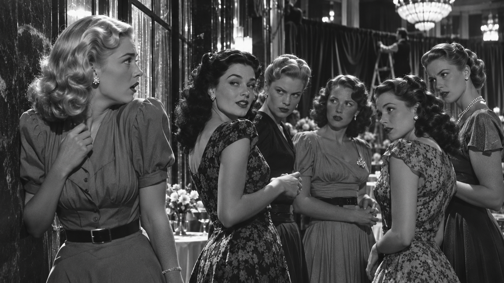

# Debutantes

Sitting in the lobby since the night before, and for the entire time Reggie and I walked what I was increasingly convinced was about to become a crime scene, I had my trusted contact, Mickey "The Meter" Malone, watch Weatherby's office.  Mickey was a cab driver and had been since the Coolidge administration. He claims just about every criminal in the city has ridden in his cab at one point, and some still do regularly. The difference is, now, they're Senators.

Before you go questioning me about drafting cabbies into my cases, let me explain: Every detective has three essential connections he relies on.  The first is a bartender who miraculously overhears news about everything shady going on.  It doesn't matter if it wasn't even said in his bar.  I don't know how this works; maybe there's a surveillance system, and they all compare notes on the weekends.

The next is a doctor who doesn't report gunshot wounds, will come to your office and do a quick suture on a knife wound, and who acts concerned when you put your shirt on and head right back out after minor surgery, even though they really couldn't care less, as long as your bill gets paid out of your estate.

Finally, and most importantly, is the mystical cab driver who knows where everything is, where everyone lives, and a mystical 4th-dimensional shortcut between where you are and where you're going that lets you beat the bad guy there. I'm pretty sure it's part of your hack license exam.  I've known a lot of cab drivers over the years. Most of them were decent fellows, but make no mistake, you are an inconvenient interruption to an otherwise pleasant afternoon of smoking cigarettes, reading racing forms, and arguing with pedestrians. Mickey wasn't like that.

Mickey was like family.  He was always there when I needed him; he kept my secrets, and he never pretended to know something when he didn't.  Come to think of it, he was better than family. He never once asked me for money or invited himself over for Thanksgiving dinner.  In return, I cut him in on the action when I felt it was safe enough and interesting enough.  Mickey had a code he lived by, and that code meant staying out of other people's drama unless you have a very good reason to get involved.  In Mickey's case, a "good reason" was defined as "a saw buck and the reasonable possibility of seeing someone get punched in the mouth."

When we hit the lobby, Reggie went immediately for the concierge desk to make himself a few nickels.  I took a seat behind Malone, facing the other direction to keep things on the down-low. “Mornin’ Meter.”

“Mornin’ Chase,” he said to the air in front of him.  Anyone watching would assume he was crazed and talking to himself.

I kept my head low, turned slightly, and spoke into my collar. “Quiet night? No one suspicious poking around the manager’s office?”

“The office was locked all night, and nobody suspicious went near the door. Since then, it’s just been various staff and debutante mothers going to talk to Weatherby.  Not that any of those dames are angels, mind you. What the hell have you gotten yourself into with this one, Chase?”

“What do you mean?”

“There are some real mean customers mixed up in all this.”

“Ah, so you spotted Luk See?”

Meter immediately started looking around the lobby enthusiastically. “No, is he here?  Gezz, it’s been forever. I’d love to catch up with him.  No, I’m talking about these society moms and their henchmen.”

“Henchmen?”

“Yeah, this one over here, Miriam Henebery, threatened to have her chauffeur feed the florist to her dogs for the carnations being two shades darker than the doilies.”

“Seems excessive.”

“No, excessive was what Josephine Seigmann told her dressmaker to do to the caterer with her pinking shears because the crumble topping on her coffee cake was too dry. These are some bad people.”

I’ve always valued Meter’s skills at reading people, so I took it under advisement. “See anybody you know among the Yakuza crowd? That can’t be a coincidence.”

“There’s Yakuza here?”

“Yeah, Luk See and a few dozen of his countrymen.”

“Those guys ain’t Yakuza, Chase. They ain’t even Japanese. They’re Chinese.”

“Chinese? You sure?” I could have sworn they were Japanese.

“Yeah, they’re all part of a group called the Tai Po Tong.  If it’s related to your jewels or your debutante’s ball, I have no idea how.”

“Yeah, but some of those Tongs can be just as bad as Yakuza, I hear.”

“Actually, Chase, that’s a bit of a fallacy, you see, the anti-Quing movement in the 17th century—”

“Give me the history letter later.” I slipped a ten behind my back and into his pocket.  “Same time tonight?”

“You got it. Watch your caboose.”  He got up and started for the exit.  

Weatherby entered the lobby seconds later, nervously wiping something off his face with a handkerchief. “Ladies, I do apologize for the interruption.  Maestro Bellamy has agreed to let you begin decorating the ballroom. However, he asked that you keep noise to a minimum and not disturb the band, as they are in a very delicate part of their rehearsals.

A smattering of approving grumbles rose from the ladies as they made their way to the elevator. I grabbed a copy of the morning paper from the table beside me and kept my eyes on the door to Weatherby’s office while he escorted the mothers to the elevators.

Sally and the debutantes got the ballroom shortly before the mothers and were shocked to see the entire north quarter of the ballroom, from the front of the stage to the freight elevators behind the stage, was now separated by a 60 -foot wall of fabric made from the blue velvet drapes that normally covered the windows on the other three sides of the ballroom, hastily sewn and tied together and hung from the chandeliers, completely obstructing the view of the stage and backstage entrance.  From behind it, a twenty-piece band played “Moonglow” with immaculate precision and competence.

All of the girls had spent the morning at an impromptu tea party held by Josephine Grapewin.  While Sally knew almost all the other girls and had actually gone to school with many of them, a small contingent of six girls from the “Upper Weaver” region kept mostly to themselves and spoke in some private code only they seemed to know.  When word came that the mothers were on their way up, and once the eye-rolling and accompanying giggles had died down, the Upper Weaver contingent disappeared to one corner, pretending to admire the late-summer view of the city below.

Sally, of course, could not bear to be on anything but good terms with anyone, and had taken it upon herself to slowly maneuver herself to that corner of the room to introduce herself properly to the group and assure them that there was no slight intended toward them or Upper Weaver in general if they felt excluded by the other girls. It was simply that they had all grown up together and gone to school together.

She stopped a few feet short, not really eavesdropping, but listening to ensure she wasn’t intruding on private business where she was otherwise unwelcome. The girls hadn't noticed her yet and continued their discussion.

The leader seemed to be a brunette she knew as Gladys Balsam, whose family built and owned a large steel mill in the mud cove area of Weaver Bay, a few miles outside the city. “We already know where the target is, and the plan has been in motion for two weeks now.  I don’t know why she’s getting cold feet now.”

“She hadn’t met the Chinese man before,” said Clara Hofbauer, a stern-looking blonde girl and heiress to a family architecture fortune whose name was on half the buildings in the city, including the Hotel Beauchamp.

“What difference does that make? We paid his fee. He’ll do as we ask,” Gladys argued.

Hilda Laskey, the rosy, strawberry-haired daughter of a prominent real-estate magnate, shook her head. “We don’t want anyone hurt.  He definitely looks like the type of person who would hurt someone.”

“He’s a professional. We told him where the target was. We told him the best time to make the snatch. We gave him the time and location of the drop-off.  He’ll do as he’s told if he wants the second half of his money.”

Pricilla Moray buried her hands in chestnut curls and shook her head. “Great, but what if our guest doesn’t go along with our plan? We’re cooked. What do we do then?!”

The sixth girl, a tall, skinny, sandy-haired girl Sally knew as Janette Kern, caught sight of her, slapped Pricilla on the arm to shut her up, and smiled broadly.  “Hello!  We didn’t see you there.  Sorry,” she said sweetly.

Sally was ghost-white by then and started walking backward.  “No, it’s completely my fault.  I just wondered if any of you wanted to help set up streamers.  I can see you’re busy, though. I didn’t mean to bother you.  I’ll find someone else. Go ahead with whatever you were talking about … I mean … if you were talking … maybe you weren't ... I have no idea what you were doing  ... as I said, I just wandered up.  I wasn’t really paying attention to anything.  Well, okay, we’ll talk later then.  Bye.”

While all this was going on, Reggie and I were down in the lobby.  He was straightening a particularly odd-looking potted palm when the over-eager, underfed debutante he’d failed to notice was stepping off the elevator.  She was now dressed in a modest dress and had let her hair down so it rested in waves on her shoulders.  She looked, if possible, even more dangerous than she had the day before.

"Oh, Reggie," she said teasingly. "I'm glad I found you. I was just thinking about you.”

"Yes, miss.  What can I do for you?"

"I need more towels for my bath.  I want to take a particularly long, hot soak.  This hotel just seems to demand it, don't you think?

Reggie bolted upright and nodded.  "No problem, miss.  I know where to get the big, fluffy ones, right out of the dryer so they're still warm even."

"That would be lovely, thank you, Reggie."  She suddenly began admiring the chair next to her, caressing its back with her hand. "This hotel is so romantic. Don't you think so?  It's all full of old wood and history. I bet this chair has witnessed a lot of scandals in its time.”

Reggie nodded. “Yes, miss. It was built in 1912 by the famous architect, Arnold Montgomery. He made most of the best buildings in the city and was famous for his attention to putting unique details in each one.”

She smiled at him like he'd just fallen into a trap. “Unique details? How intriguing. And what sort of… details were these?”

“Oh, all sorts.  Every building had a different one.” Tommy brightened, clearly on familiar ground. “Ours is a small rooftop observatory you can get to from the twenty-fourth floor. Only a few people know it's there, but it's spectacular. It has windows on all four sides, so you get a view of the city on all sides--the marina, the bridge, ships coming in from Weaver Bay.”

The girl went very still as a slow, delighted smile curved her mouth. "Oh, my," she began, fanning herself. "Why, Reggie. Are you suggesting what I think you’re suggesting?”

The kid arched an eyebrow. "I just mean it's a fascinating feature, architecturally speaking.  I mean, if you wanted to see it.  The stairs are a bit steep, but the view is worth the climb."

“The view,” she murmured, eyes turning glassy. “Oh, I love a good view except when it gets interrupted. You did say it was relatively unknown, right? Not the sort of place one might be interrupted?”

“Well, it’s not locked, and it's open to guests,” Reggie said helpfully. “Most people forget it's up there, though.”

"Mmmmm. I love a quiet little spot with windows on all sides. It's so... exposing.” She looked up at him eagerly. “So, Reggie, do you ever go up there yourself?”

“Sometimes, I go up there for lunch if the weather is nice and watch the boats while I eat a sandwich.”

“Without anybody bothering you,” she echoed, almost reverent. “How perfect. So, what time does your shift end?”

He opened his mouth to answer, and I was almost happy for him, even though he didn't yet know what he'd agreed to.  Sadly, Sally Montana instantly interrupted him, bounding out of the elevator and running straight up to him.  "Reggie, you won't believe what I saw!  Where's Mr. Chase?!  Oh, hello, Darcy."  She smiled, appearing only slightly annoyed to see Reggie was speaking to another of the Debutantes.

"Hello, Sally," Darcy said coldly, then turned back to Reggie. "I'll see you later then, Reggie. Don't forget my fluffy warm towels."  She blew a kiss as she headed for the elevators.

"I didn't know you knew Darcy Montgomery."

Reggie straightened his collar. "Is that her name?"

"Yeah, I figured everyone knew that.  Her grandfather designed this hotel."  

Despite my best attempts to blend in with the wallpaper, she spotted me and spent the next ten minutes recounting everything she had seen upstairs, including her run-in with a possible Yakuza or Tong assassin. None of this seemed to phase her, of course. After detailing everything, she reminded me, as if I was the amateur, to stay alert and keep watching the jewels.  She was going to investigate the girls, the Chinese man, the drop-off point, and the so-called timetable.

I knew I should have spotted it the moment I laid eyes on the kid. She was another one of those reckless girls who thinks she's Nancy friggin' Drew. They were everywhere these days. Now, I've never actually crossed paths with Nancy Drew, I think she works mostly on the west coast.  Good thing, because if we ever crossed paths, I'd love to take that girl to task for claiming to be a detective.

For one thing, she's only sixteen ... though I think this is probably a ruse. She's been in the business and has been sixteen for at least ten years now.  Hell, it's probably the only reason she's still alive. During that time, she's apparently faced smugglers, criminal conspiracies, and forgery rings. I also heard there may have been a kidnapper in there somewhere. The point is, as far as I know, the worst thing that's ever happened to her is she got clocked on the head a few times, nearly drowned -- though this was an act of nature and not the bad guys -- and got tied up and left to starve in the basement of an old house once.  I mean, sure, these guys usually have soft spots for young girls, or girls pretending to be young, but it seems to me if I broke up a smuggling ring, I'd be carved into bite-sized portions and fed to their dogs.  The ones she meets helpfully explain their plans, lock her in a closet, and she gets rescued an hour later by a friend with a convenient flashlight and hairpin, and the criminal enterprise is suddenly insolvent by dinner time.

Is this girl even licensed? I assume not, since she doesn't charge anybody and presumably covers her own expenses, too. That's where stuff starts adding up, too. Forget office rent, a license I have to keep current, and the occasional bartender who gets fixated on collecting a long-standing tab.  Do you know how many bad sandwiches and bottles of rye I've had to consume in my car while the person I'm tailing sits in his apartment doing absolutely nothing interesting? It starts to add up. Must be nice to have a rich lawyer father who pays your bills and buys you ice cream for making his job easier.  My old man was apparently kidnapped by a pair of cocktail waitresses 35 years ago and hasn’t been seen since, according to my mother.

So, fine, let little Sally Montana have her fun and solve the case.  Just once, I'd like to find an important clue in an abandoned mansion, secret passage, or under a mysterious staircase.  The real world doesn't work like that, though, and I was pretty sure that, by the end of the weekend, I'd either be bailing Sally Montana out of jail for felony obstruction of justice or untying her from a chair next to an old grandfather clock somewhere.
