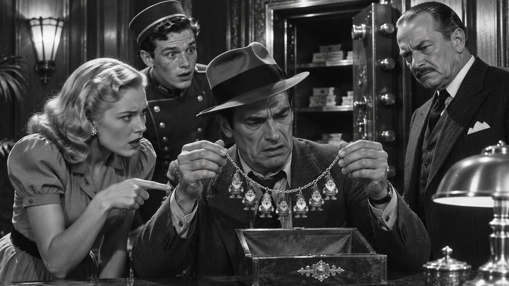

# The Long Lunch

By mid-afternoon, sitting around watching Weatherby’s office from the lobby, I was getting a bit stir-crazy. East Asian men in expansive suits continued to stream in at a regular pace, each expertly handled and placed by Reggie and Eugene. The tong was definitely up to something. I just hadn't figured out how they fit in with a debutante ball and likely jewel heist, though.  Twice Luk See wandered through the lobby, each time giving me his smug self-assured smile and a little salute with the tip of his wide-rimmed fedora. I was certain he knew what was going on, but I couldn't risk dropping my guard on Weatherby's door.

Around noon, a boisterous man in an equally boisterous suit wandered in and slipped Reggie a fiver.  I later learned he was Thurston Goldstien, city water commissioner, and something of a notorious ladies’ man.  He was formerly attached to Eliza Softfoot, a noted socialite and tea snob from the Roberts Peak area, but that apparently fell apart months ago during a complex situation during the great blackout.

“Mr. Goldstein?” Reggie was always careful when interrupting important people. “Mr. Weatherby was hoping he could get you to look into a few matters for us here at the hotel.”

“Oh, what would those be, my boy?”

“Well, many of the guests are complaining about  a metallic taste in the water.”

“Yes, well, I suppose I could have a look at that.  They’re all pretty busy, but I can have someone out in the next three weeks or so.”

“Oh, I’m sure Mr. Weatherby can’t want that long, Mr. Goldstein.”

Goldstein looked around the lobby, eyes landing on a group of debutantes in the corner. “Say, you seem a smart young man who is very much in the know about things around here.  What’s the name of that young lady over there by the elevators in the green dress?”

“That would be Marla Darwell, Mr. Goldstein.”

“Darwell, you say? Is her father by any chance Hubert Darwell the city treasurer?”

“I believe he is.”

At this point, Goldstein let out an inhuman laugh.  Something between a hyena and a ferret with its tail caught in a door.  “I tell you what I’ll do, my dear boy.  I’ll have someone down here to look at your strange taste tomorrow morning if you would do me a great favor and  introduce my nephew Elroy here to Miss Darwell, and, you know, give him a boost?”

“A boost?”

“Yes, a boost -- a little backstory, a small anecdote to elevate his stature, a harmless little white lie to make him sound impressive.”

Riggie nodded.  “Ah, a boost. Well, I suppose, but my boosts are particularly good.  I think a boost requires you also look at this mysterious green runoff coming from one of the pipes by our loading dock and figure out what that’s all about?”

“Green runoff you say?  What kind of green runoff?”

“The kind that comes up from an underground pipe, spills all over the place, and then disappears down into the sewers again.  Oh, and it glows in the dark.”

“Glows in the dark?!”  Goldstein appeared concerned at that revelation.  He began scanning the lobby again. “Okay, my boy, I’ll tell you what.  I will have the men come to look at your green runoff and metallic taste tomorrow.  You will introduce Marla and Elroy aaaaand provide a suitable boost.”  He extended his hand and was about to finally seal the deal when his eye was caught by another woman with platinum blonde hair and red skirt.  He made a series of “Aie, uhhh, oooooh” noises and instantly went back to negotiating.  “Who is that lovely creature in the red skirt?”

Reggie began examining his fingernails.  “Oh, her? I don’t think she’s for you, Mr. Goldstein.”

“Nonsense, a beautiful woman like that.  Who is she?”

“I probably shouldn’t say. We do like to respect the privacy of our guests.”

“Fine.  Then I’ll speak to you tomorrow when the water department gets here.”

“That will be fine sir.  Though I imagine Ms. Henebery will be quite disappointed.”

“Ms. Henebery?”

“The Widow Henebery, yes, sir. The blonde with the red skirt. She was asking me earlier about distinguished gentlemen attending the ball.”

Goldstein’s eyes lit up. “Was she, now?”

“Yes, sir, she’s very particular about civic responsibility, though.”

“Civic responsibility, you say?”  His voice wavered just a little.

“Oh, yes. Says there's nothing more attractive than a man who gets things done.”

“She did, did she?” His tone had collapsed.

“She has reservations tonight.  It will be a shame if her water tastes like metal.”

“Reservations at the restaurant … tonight?”

“7 PM reservations, yes sir.”

“Fine.  I’ll have someone here before the dinner rush tonight.”

Reggie held out his hand.  Goldstien shook it.  

“She's one of the debutante mothers.”

Goldstein perked up a little. “Well, I will definitely have to introduce myself at the ball tomorrow.”

“If you would like to negotiate for table misassignments, I will be here all day.  Provided we don’t have some other water-related emergency that takes me away from my duties.”

Goldstein eyed him for a second. “What’s your name, son?”

“Reggie O’Grady.”

“You’re a haaaard man, O’Grady.”[ Yes, I am aware its not at all funny.  It IS word count, however, approximately gag-sized and its action is plot shaped for what will eventually go there.]

Meanwhile, in the lobby, I was camped out on the nicest couch they had with a newspaper I was only pretending to read. Frankly, I'd had my fill of East Asian gang members and watching Weatherby never come out of his office when I got a light tap on the shoulder.  I turned around and found myself face to face with Alister Pierce.

“Jack Chase,” he said.

“Detective Pierce,” I said, going back to my paper.

“Not anymore, thanks to … well, okay, maybe I still am.  Fine, you win that round, Jack.” He bristled a bit as he brought himself to his full height. “What are you doing in my hotel, Chase?”

“Enjoying the free cookies and complimentary newspaper. Don’t worry, I didn’t touch the little soaps.”

“Don’t get cute with me, Chase.  My boss doesn’t want you here and told me to remove you if I see you sneakin’ around. Now, we can do that the easy way or the hard way. Please, pick the hard way.”

“You know, Pierce, sometimes I get the feeling you don’t like me much.”

“You got me kicked off the force, in case you didn’t know that.”

“I helped you get off a public official salary and into private practice.  Tell me you’re not doing better being Weatherby’s muscle than you did in blue.”

“You told them I was brutal and violated a citizen’s rights.”

“Okay, now that’s just not true. I told them you were brutal, violated a citizen’s rights, and that you were an incompetent moron, but I guess they dropped the charge on that last one?”

“I never did no such thing, Chase.”

“Pierce, I was there.  Summer of ’36, Katz Brother’s Deli and Grocery gets robbed.  I’m working the case, finding out who robbed them. You came in and started interrogating suspects. You beat one of them to a pulp.”

“That’s how you learn things in the detective business.  You ask the right people the right questions.”

“He was one of the Katz brothers, Pierce. One night he gets robbed, the next morning the investigating officer puts him in the hospital … why? … because he knew too much?”

“Yeah, fine, don’t pretend you never played a hunch, Chase.”

I rubbed at my forehead. “Why don’t you go beat a confession out of a double-parked car?”

“Maybe I will, but in the meantime, the boss wants you out?”

“For what?”

To his credit, Pierce actually stopped to think about this for a moment. “For makin’ us look back doing my job for me.”

“So that implies one of the guests hired me to solve a crime, doesn’t it?”

“You know it does, Chase.”

“Do I look like I’m trying to solve a crime, Pierce?”

“Well, no but—"

“For that matter, are you aware of any crimes that have been committed around here lately?”

“Of course not, but--”

“Of course not, because you’re doing a stellar job. Nobody would dare commit a crime while you’re around.  In fact, having me sitting in your lobby, not solving a crime -- because that would be your job -- is really making you and your hotel look really good, don’t you think?”

“Now wait a minute, Chase—”

“No, honestly, you’ve been very good about warning me off solving any crimes around here. I am convinced that I should just sit here and enjoy the complimentary newspaper and the cookies.”  I took a bite of the cookie to drive my point home.  I was pretty sure it was at least three days old.  “On second thought, tell the concierge the cookies are a bit dry.  Do you have a pot of coffee around here somewhere?”

“Listen to me—”

“I did listen, Pierce, and you won.  You may tell your boss that you have shown me the folly of attempting to solve a crime on your turf, and you have done it with admirable restraint.”

His eyes suddenly lit up. “Wait. Would you say I was discreet?”

I thought for a moment. “Well, you were certainly low-key. You didn’t make a ruckus or destroy anything. No one was injured.  Yes, I’d say you were quite discreet.”

He suddenly seemed quite pleased with the situation.  “Okay, Chase, read your paper.  Don’t let me catch you trying to solve any crimes around here, though.”

I smiled and went back to pretending to read my paper.  “Hand to heart. I wouldn’t dream of it. You’re the detective, after all.”

He started walking off, got about four paces, then turned around. “Okay, then, but I’ve still got my eye on you.”

“I feel safer already,” I called after him, grateful I still had all my teeth when Sally Montana tapped me on my left shoulder.  I let out a little shout of surprise.  The girl was surprisingly stealthy and had somehow gotten inside my perimeter.

“You gotta quit sneaking up on me like that, kid, I'm on high alert here.  I might have drawn and shot you.”

Sally, ever the cool one, simply shrugged.  “Did you get my note?”

“Yeah, kid, I don't know what you heard, but it makes no sense--"

“I’m telling you, I HEARD them say they hired a Chinese man to do some kind of job for them.  They’re going to meet with him later.  That means he’s done it already, or he’s about to do it.”

“A Chinese man, you say? Well, I guess that narrows it down. I count only 150 people in the hotel matching that description right now.  What makes you think they hired him to steal your necklace and not carry their sash, or whatever it is you debutantes hire people to do?”

“They've met him, some of them have talked to him. Some of them are afraid of him and think he's going to kill someone.”

“Good bet, and also the reason I usually stay out of things like this.”

“Mr. Chase, I don't want anyone to get hurt on account of my necklace.”

“Professional jewel thieves are rarely cold-blooded killers, kid.”

“Still, I would feel bad if--"

“Look, kid, even if they were out to steal your necklace, there's a very fine line between hiring someone to steal something and them actually being able to pull the job off.  I'm all over this thing. There have been eyes on that office constantly since last night. Trust me, nobody has gone into that office unless it was to see Weatherby or Carson.  I promise I'll be extra alert if one of the Chinamen pays either a visit though.”

“And what if they've already gotten it and you missed it?”

“Kid, I guarantee you--"

“Please, Mr. Chase! It’s worth a lot to my family and me.”

“Okay, look, if I show you how secure your necklace is and how impossible it's going to be for someone to make off with it, will you let it drop and let me do my job.”

Sally thought for a moment, then nodded.

“Fine, then since it's your necklace, all you have to do is go up to that front desk clerk there and ask them to show you the safe and the security precautions around it.”

Sally raised one eyebrow as if it had never dawned on her that she could just “do that.”  Jack motioned for Reggie to join them as he followed her up to the desk and into Weatherby's office.

“So.” Weatherby sneered. “You must be the private dick that's been disturbing my guests and borrowing my staff with an unauthorized investigation.” He gestured toward Reggie.

“Name's Jack Chase. I’m not investigating anything, and if you don't open that safe for this girl right now, I’ll stop being discreet about it.”

Weatherby stared at me for a moment. Then slowly pushed his chair back from his desk to reveal the safe. He spun the wheel like an expert, almost instinctively stopping on the correct number each time.  Numbers, I noted, that he had committed to memory.  When the sequence was done, he pulled the large, silver handle and the safe effortlessly opened revealing a large wooden box.

“That's it, Sally said.”

Weatherby removed the box and set it on the desk.  She opened it slowly.

“And there are your jewels,” I said confidently as I got his first look at the necklace that had been the cause of all of his problems for the past two days.

“Jack…” she said quietly.

“It's beautiful.  I could see why someone would want to steal it.”

“That's not the Green Destiny.”

“How can you be so sure?”

“It's made of plastic.”

I stammered for a moment. “A lot of plastic is really quite valuable.  As a polymer, it's almost completely--"

“It has a Disney logo on it.”

“They’re one of the wealthiest, most powerful families in America. I’m not surprised you--"

“It doesn't even have a giant emerald.”

“Giant emeralds are out of season anyway--"

“It has charms of the seven dwarves.”

“Dopey is often seen as a sign of male virility--"

“Oh, my god!”

Disheartened, I began running scenarios in my head.

Reggie, standing in the doorway, covered his gaping jaw with his hand. “How did they get the jewels?”

Suddenly, it dawned on me.  “Because, like an idiot, I announced exactly how to in the lobby yesterday afternoon. I even suggested swapping in a duplicate to temporarily allay suspicions. They stole my plan!”

“Well, at least you know it was a good plan.”

“Kid, you don’t get it.  Some second-rate jewel thief outsmarted me, cost me my $200 bonus, and what’s worse, I did the thinking and told them exactly how to do it!”

“Well, maybe if you tell Miss Halston-Kensington, she’ll give you a partial bonus then.”

“No, kid, the only way we’re going to get out of this is to get Miss Montana’s jewels back.  For that I need your help.”

“What do you need, Mr. Chase?”

“We can be reasonably certain whoever committed that crime was in the lobby yesterday near your stand when I alerted them to the jewels and gave them the plan. If they were in the lobby and didn’t commit the crime, then maybe they saw someone who took a particular interest in us and my story.  For that, we need to go through your register and find everybody who checked in or out during that time.”
