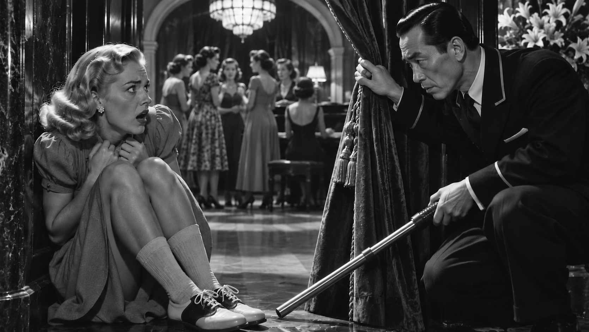

# The Debutante Conspiracy

While Reggie and I, in a turn of fortune that I probably should have seen coming, were being chased by zombies and targeted by a particularly malicious ventriloquist’s dummy that I was sure was targeting us, little Sally Montana was doing her part, in a cute little kid-detective way, to solve the mystery of her stolen jewels. Once the obligatory dinner was completed, celebrating the tireless few who showed up early to hang tissue paper and streamers, the parents retired to the lounge and left the debutantes to their own devices. Sally kept a close eye on Gladys Balsam and her Upper Weaver conspirators.

The group had gathered in one of the sitting rooms adjacent to the banquet hall on the second floor to hear Hilda play a rather poor rendition of  “Goodnight My Beautiful.” Sally parked herself just around the corner of the room’s arched entryway, hiding behind the curtain, and straining to hear the muffled conversations beneath the awkward playing and Janette’s wobbly singing.

“We’re certain everything is ready for tomorrow?” Gladys said, in her usual authoritative tone that bordered on condescension.

“Our man will be bringing him by at 7 PM,” Clara said. “I figure we’ll meet with him and make our proposal straight away.  He sure to accept, who could resist? After that, the hard part will be keeping everything quiet and under wraps until the ball starts.”

“Remind our friend to be very careful with our guest,” she heard Gladys say. “If somebody sees him and recognizes him, it’s all over.  If they should somehow learn we’re involved, it would be even worse.”

“We just need to keep everything together for an hour or so. Once the ball is in full swing and our parents have had a few drinks, it will be easier to move around,” this was from Pricilla.

So that was it, Sally realized. They stole the necklace and were handing it off to someone tomorrow night.  The only question was: For what?  Who was the mysterious man who was coming?  What did he have to do with the necklace?  Was he a fence of some sort?  

“That’s another thing to consider.  What if Bellamy refuses to go along?” asked Janette, who always seemed to be nervous about something or other.

Bellamy? Sally thought. It made sense.  The only time Bellamy had left the ballroom was to go down to Weatherby’s office. Did he somehow steal the necklace while he was in there?  The timing fit, but it would have meant Weatherby was somehow involved.  So, what role did he play? Was he behind all of this, or just someone they’d duped into going along?

“By that point, he won’t have a choice if he knows what’s good for him. I’m telling you, this is all going to work. What’s better, is that we’re doing this all on our own, without anybody’s help.”

That was it, wasn’t it? Somehow these six spoiled socialites were the masterminds behind the theft? It seemed highly unlikely to her.

“Well, it was my older brother who gave us the idea,” Hilda Laskey said. That made a degree of sense. Sally remembered hearing her brother was some kind of radio journalist. It’s likely he heard the story of the necklace, its importance, and its unveiling.  It was conceivable that he pointed this out to his sister, possibly looking for a story.

“True. We came up with most of the actual plan, though,” Gladys corrected, obviously wanting to maintain her fragile hold on the leadership of the gang.

Janette chimed in on cue. “Well, technically, we did hire that scary guy to the dangerous parts.” She was the only one who seemed nervous about him.

“Okay, I suppose we did.”

“And it was my trust fund that actually paid for his services,” Pricilla chimed in.

“And we’re very grateful for your sacrifice.”

“Of course, our parents set up the entire ball, otherwise what was the point of doing any of this?” Hilary pointed out.

“Yes, obviously our parents setting up the ball in the first place, otherwise we’d look like a bunch of complete idiots right now.”

“Speaking of which, should we have food or something ready for our guest? It might make negotiations go more smoothly if they’re not done on an empty stomach,” Janette said. Honestly, judging by her appearance, food was always foremost on her mind.

“Oh, my mother is in charge of the catering,” Pricilla offered. “I’ll have her order an extra fruit tray and redirect it up here.”

“We still have the problem of getting everything to the ballroom for the big reveal,” Gladys said, trying to steer the conversation back to logistics.

“I think that night shift bellboy, Eugene, fancies me.  I bet I can talk him into it,” Hilda said.

The curtain was suddenly thrown back, and Sally let out a little shriek of fright as she found herself face to face with an angry-looking man, one of the group that Jack pointed out as “a Tong.”  He wore a black suit and tie and stared at her accusingly with dark eyes.

“I’m sorry, you startled me,” she whispered, not wanting the Upper Weaver girls in the next room to hear her voice while they were going over their plans for the following evening.

The man tapped her feet with a long metal pipe of some sort. Did he mean to break her legs?  That would mean he must somehow be involved with the girls and their plans. It dawned on her that he was like the Chinese man the girls had hired to transport her stolen necklace. She thought briefly about calling him out then and there, but couldn’t find the courage.

The man tapped her left shoe, then her right shoe. She looked at him, confused, until he made a gesture with his hands.  He wanted her to lift her feet.  Slowly she obliged by lifting her left foot. He immediately reached down and grabbed it, turning her foot to expose the sole of her saddle shoes. He studied it for a moment, then let it go, grunted, and pointed to her right foot.  She repeated the process.

It dawned on her that he was likely determining the size of her feet in order to pick the bucket they would soon be cemented into.

Eventually, he made a similar grunting noise and released her right foot.  Then he mumbled something in a disappointed tone and began shaking the pipe in his hand.

“Look, honestly, I didn’t hear anything.  I just heard the piano and decided to come listen. I don’t know anything about whatever they were talking about, any plans they might have, or anything involving you, so I’ll just be leaving now. I think I hear my father calling. he’s a very powerful and influential person you know…” She quickly ran out of breath and darted for the elevators.

The Chinese man didn’t follow.

She caught up with Reggie and myself in the lobby five minutes later babbling something about a grand conspiracy involving the Maestro, a hired Tong assassin, and the Upper Weaver debutante sect.  Whatever they were planning, it appeared involved the Tong guy bringing someone to them the next night at 7 PM right before the ball. Somebody they needed to keep under wraps. They apparently had Bellamy involved too?  I didn’t like the sound of that, considering who Bellamy had working for him.

“Look, kid, maybe you shouldn't be involved in this. I'm hired to make sure your perfect evening goes off without incident, and while I appreciate what you've done up to this point, this lollipop is about to get dog hair all over it.”  I briefly explained about Bellamy's zombies and the 90% probability that the mastermind behind all of this was a ventriloquist's dummy that fool Reggie had left unattended in an elevator. She failed to see the relevance of any of it. That's because Nancy Drew hadn't seen the kinds of things I'd seen.  She was too busy looking for footprints in the dust of old abandoned houses and following strange lights in windows. Real detectives don't do foolish things like that, especially without charging someone for it. We’ve been in that stuff, up to our armpits in ghosts and mole men. We've learned our lessons.

“Why can't you just say it, Mr. Chase?”

“Say what, kid?”

“That I've gotten further than you on this case, and I'm close to cracking the entire thing without you.”

“Kid you haven't scratched the surface of what's going on here, believe me. When Captain Hush back there finally wakes up and summons his armies--"

“A simple, ‘Good job, kid' would suffice.”

“You can have your ‘good job' when you figure out what the brat squad is planning.  Right now you only know the WHEN.  We still need to know HOW Bellamy is involved, WHY the Chinese Tong are involved, WHO actually stole your necklace, and WHERE it is now.”

“Can you at least admit I'm one interrogative pronoun ahead of you?”

“Fine. Good job, kid.  I'll take it from here.”

“The hell you will, old man.” She smiled politely and skipped off toward the elevators.

Once she was completely out of sight and on her way up, I looked over and saw Reggie, looking not unlike a puppy and slobbering all over his bellhop uniform. “Jeez, kid, do you need to go walkies or what?”

“Isn't she wonderful, Mr. Chase.  Smart, tough, wise--"

“—and looks great in knee-socks and saddle shoes?”

“Yeah…”

I smacked the back of his head so hard his hat flew off. “Knock it off! I need your head in the game! My eyes and ears, remember?  Now come on, we've got work to do.”  
