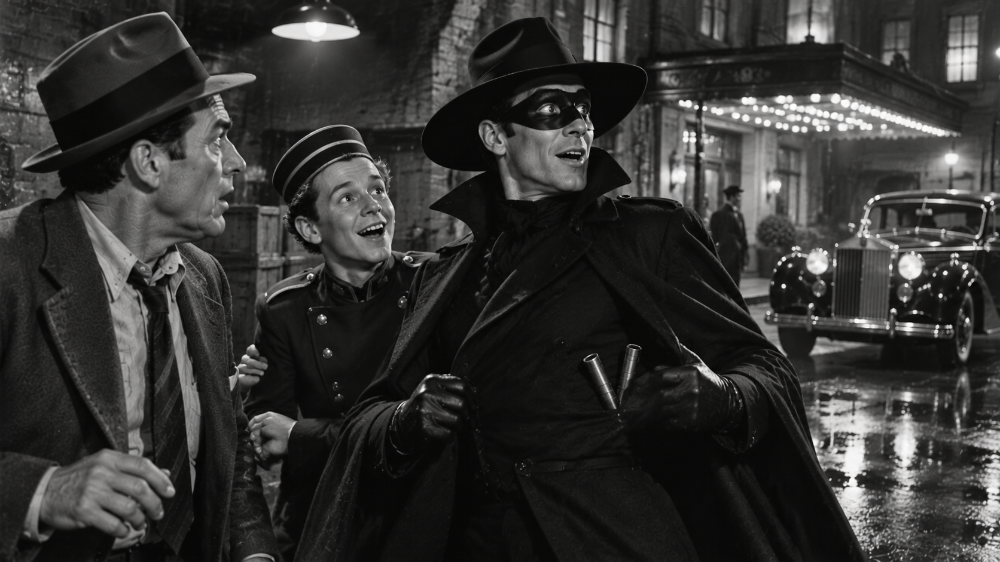

# The Apparition

“Apparition, eh?  What’s that make you, some kind of masked vigilante?”

He made a flourish with his coat and struck a pose as you would find in a comic book. “Defender of the innocent. Friend to those in need. Scourge of evil doers,” he said loudly and with the enunciation of a sportscaster announcing the home team.

“Okay, look, we’re going with subtlety to secrecy regarding the whole zombie thing right now. Will you keep it down with the voice, maniacal laughter, and the firearms already?”

“They’re not actually firearms.  They’re air guns, loaded with rock salt.” He pulled back his coat, revealing the pipes hanging inside. “Pump action for stealth and silence. It won’t stop them, but they make them rethink their decisions for a few minutes.”

“Rock salt,” I said, disbelieving. “These guys have no internal organs, don’t feel pain, and seem singularly focused on brain eating, but you rub salt in the wounds and---"

“Zombies strongly dislike salt. It reminds them they are dead and makes them self-conscious about their current appearance.”  

“How do you know all that?”

His voice went back to being bombastic. “I was trained by an ancient Haitian Vodou Master at one of their temples.  I learned their mystical ways, their ancient incantations, their sacred combat forms---“

“Did you learn how to keep your voice down?”  I grabbed his arm and led him through the exit out to the loading dock.  He felt a bit skinny under that coat.

“I was taught to strike fear into the minds of the evil---”

“Seriously? How many zombie invasions have you fought off?  A few, right?  With a name like The Apparition and the whole undead motif going on, you must be an expert on this stuff.”

“Well ... okay, technically this is my first.  I did a lot of reading during my time at the temple, though.”

I considered this, then decided book learning would have to do in the pinch we were in. “Okay, fine.  The pop guns are nice.  You’re probably packing a whole arsenal of secret totems, spells, and incantations, though, right?”

He shrugged. “Not really.  I use these against bad guys most of the time. I just happened to know they work even better on Zombies.”

“You’re an ancient Vodou disciple trained to hunt bad guys and not undead incursions?  They teach that in their temples?”

“Well, to be honest, it was a really liberal arm of the Vodou church. It wasn’t even really much of a temple. It was more like ... a proxy...”

By now, I was ready to strangle the guy. “Proxy?  Why am I starting to think you’ve never been to Haiti?”

“Well, New Orleans, actually, but it was on Bourbon Street.”

“So, that makes it legit.  Let me guess, an economy tour gone wrong? You got lost and wound up getting taken in by a con artist who runs one of those voodoo fortune-telling shops down an alley somewhere.  He got the last of your money, but in exchange you got the secrets of the afterlife?”

He shrugged. “Something like that.”

“And how long did you train with this guru of yours?”

“Two weeks, but they were very long days.”

“And you think this qualifies you to be a masked vigilante?”

“It opened my mind to the arcane. I’ve dedicated my life to filling my head with such knowledge.” He was starting to lose his cool, and the pitch of his voice was creeping up into pre-pubescent boy territory. “I don’t have to answer to you. You’re just some private dick -- whose life I saved, I might add -- thanks to that knowledge.”

I nodded to concede that one. “Fine, know any other tricks?  We’ve got a real undead problem going on here. Some of them seem friendly enough. Others have started eating the staff.”

He nodded. “A newly raised zombie is bound to its last earthly obligation.  Until they fulfill it, they aren’t truly free to roam as undead.”

“That doesn’t make sense.”

“Of course it does. Those musicians are union. They’re under contract to perform tomorrow night at the debutante ball. Practicing is part of that contract.”

I studied the Apparition for a moment.  Was he for real? “Obligation? This is the musician’s union, right?  I mean we’re not talking about teamsters here.”

“What do you think happened to Robert Johnson?”

“The blues guy?”

He nodded, then finally dropped his voice into a conspiratorial whisper. “Died at age 27 under mysterious circumstances. No cause of death on the certificate. No autopsy. Not even a body. They’ve got three fake graves in Mississippi to keep you distracted. These are not people you want to mess with. They’re people that make things happen.”

“Yeah, but that’s---”

“Remember what happened to Mozart.”

“Is he the drummer for the Ink Spots?

“Trust me, it’s binding. As long as Bellamy doesn’t end the rehearsal, they’re spiritually bound to keep practicing.”

I nodded. Beginning to catch his point. “Except for the union-mandated smoke breaks.”

“Which they take, and then promptly return to practice, yes.”

“That’s why he’s doing that? He’s afraid the musician’s union?”

“And rightly so.”

A familiar voice came from inside the hotel behind us. “Okay, I’ve got the suite number for Sally.”  Reggie suddenly appeared next to me.  He regarded the Apparition as if vigilantes in domino masks were a common site at the Hotel Beauchamp. “Oh, hello,” he said.

The situation was too ludicrous not to play along at this point. “Reggie, this is The Apparition.  Apparently, a masked vigilante trained by ancient Haitian Vodou Masters who cleverly disguise themselves as Bourbon Street con men and fortune tellers. He does, however, have some insights about zombies and a couple of zip guns that get their attention quickly enough.”

“Jack, that’s Carl Moesby. He’s the head valet.”

The Apparition appeared a bit taken aback, almost hurt, by the accusation. “I am The Apparition. Defender of the innocent. Friend to those in need. Scourge of the evil-doers--”

“Was that a Rolls-Royce Silver Wraith that pulled up out front a few minutes ago?”

“Silver Wraith?!” The Apparition now appeared to divide his attention between us and trying to look around the corner at the main drive.

I tapped him on the shoulder to get his attention back. “Look, I don’t care who you are, but so far your theories have held up better than anything else I can think of.  What else did you learn in your research?”

“It’s not exactly research. Well, I mean, the salt stuff is pretty well known to ward off most evil spirits. You learn that stuff the first day.”

“What about binding them with contracts?”

“Not just contracts, it’s  any duty their living form felt obligated to.”  He looked around to make sure nobody else was within earshot.  “Okay, look, most of the valets are zombies and have been all day.  Thing is, aside from the stench and random body parts that tend to fall off and roll under the seat, they do a perfectly serviceable job of valeting.  Well, at least until their shift ends and they go all bitey and brain eatey.”  He strained again to get a look at the front door.  “I really don’t need one of them stinking up a Silver Wraith, though.  Look, you seem to have a really good system of sending them down to the storage area, and they seem content to wander around down there and not bother anybody up here.  I’ll keep feeding them to you, and you keep hiding them.  If they’re all contained, they can’t infect anyone and make more.  We can figure out what to do with them later.”
