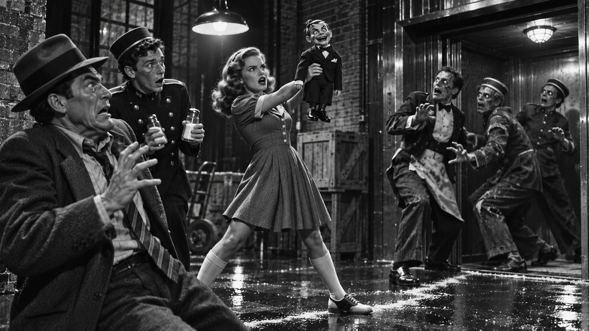

# Dr. Whispers

Sally knocked on the door to 1517.  There was no answer.  She fished the master key Reggie had given her out of her pocket and slipped it in the lock.  The door opened, and to her surprise, the room was lit up.

“Mr. Berkman?” she called.  She’d heard his radio show many times, and was quite familiar with him and Dr. Whispers, who she’d only seen on marquee posters before.  It would have been great to meet him.  Still, she couldn’t resist the opportunity, set the case down on the bed, and opened the latch.

As expected, quiet, unthreatening and, to her, cute as could be, was Dr. Whispers, staring blankly at the ceiling.  She carefully picked him up and regarded him.  “Why, you don’t look scary at all.  I wonder why Mr. Chase is so terrified of you.  I can’t imagine you’d hurt anyone.”

An inhuman shriek of terror suddenly filled the room. Sally whirled around and saw a zombie in a maid's costume, holding a sponge and toilet brush in the bathroom doorway.  Sally instantly joined in with a scream of her own.

The “maid” held up the sponge to block her view of Sally and frantically waved the toilet brush in the air like a sword.  Sally jumped up onto the bed, instinctively holding Dr. Whispers out in front of her like a shield.  The Zombie shrieked again and ran from the room.  Sally tried to catch her breath, then realized she’d just turned a zombie loose on the 15th floor the night before the debutante ball.  Still clutching the dummy, she ran out into the hall after it.

“Wait!  Come back!” she cried.

In the hall, she saw other guests peeking their heads out of their doorways.  Most just stared disapprovingly at her as she ran past.

She finally caught up with the zombie maid the employees-only area, waiting on the service elevator.  It shrieked again when it saw her and ran to the corner of the room, crouching in a fetal position.

“Look, I’m not going to hurt you,” Sally said, in a calm, soothing tone. “We just can’t have anyone seeing you.  At least, not until the debutante ball is over tomorrow.  See, they stole my necklace, and I have to get it back.  If there’s no ball, then I lose my chance to do that.  I hope you understand.”  She risked stepping toward the Zombie, which screamed again.  “Okay, apparently I frighten you more than you frighten me.  That makes... no sense ... but okay.”

Behind her, the elevator dinged.  She stepped back, clearing a path between the zombie and the elevator.  The doors opened to reveal another zombie in a tattered bellboy uniform, missing most of his right arm.  Sally shriked and hid behind Dr. Whispers.  The bellboy shrieked.  She turned to run for cover in the corner next to the zombie maid, who shrieked.  Finally, it dawned on her.  She stood up, grabbed the dummy, and did her best impersonation of Dr. Whispers.

“Everyone be quiet!” she said, then made the dummy look directly at the bellboy. “You, get back in that elevator!”

Slowly, Eugene took two timid steps back into the car holding up his one good hand for protection.

Next, she turned the grinning face toward the maid.  “You, get in there with him.”

The maid crawled on all fours, hissing and moaning the entire way into the car.  Both cowered in the far corner.  Sally reached, felt around for the buttons, and pressed the bottom one, assuming it was the basement.

“And don’t come back up here!” she said, shaking the dummy ominously at them as the door closed.  She watched the dial above the door track the car’s descent, finally stopping in the basement.  She breathed a sigh of relief, then, still clutching the dummy, ran for the main elevators on the other side of the building.

While all of that was going on, Reggie and myself were hanging out on the loading dock.  The Apparition -- well, Carl -- had given us the skinny on how the undead thought, and warned us he’d be driving newly freed valet zombies our way as soon as their shift ended.  So far, we hadn’t seen any.

A voice echoed down the service corridor.  “... and you know Stewie ... [hic] ... yer alright in mah book yahearme? ... [hic] ... yer alright ... a regulahr shtand up fella ... [hic] ...”  A stout man in a derby was being helped down the hallway, leaning on a zombie in a tuxedo.  Neither seemed to be moving in a very straight line.

“Let me guess?  Stewie is the bartender?”

Reggie, stone-faced, regarded the two and nodded slowly. “His name is Trevor, but that’s definitely him.  The drunk is Mr. Douglas.”

“When does his shift end?”

“A half-hour ago.”

“Oh, swell.”  I readied the lead pipe in my hand, half expecting Trevor/Stewie to go feral and attack Douglas the minute they hit the landing and he was no longer his responsibility.  I motioned for Reggie to step off the loading dock with me, giving the two a wide berth and me more room to swing wildly.

From our left came more moaning from what sounded like two, maybe three more zombies.  The valets had found us.  “Let’s home the Apparition is behind them and has found time to reload since we last saw him.”

Reggie snapped his fingers. “That reminds me: here!” he said triumphantly, pulling two salt shakers out of his trouser pockets and handing them to me, then pulling out two more for himself.

“You’re kidding, right?!”  I stood there with two salt shakers in one hand and a lead pipe in the other, considering which might be more useful.  It was the strangest debate I’d had in my head in five days.  In the end, I settled on putting the shakers in my outside coat pocket, next to my trusty .45.  Meanwhile, Reggie was unscrewing the lids from his and had assumed a position that looked like a grenadier.  Despite my best efforts, my eyes rolled back into my head.

Two zombies rounded the corner from the alley.  Douglas and Trevor were only just reaching the ramp down from the loading dock.  This was not going to be pretty.

“... and I never had a lot of ... [hic] ... friendsh in my life, Stewie ... but you ... [hic] ... you’ve alwaysh looked out fer me ... and I want you to ... [hic] ... know I love you.  [hic] I love you enough to tell you ... [hic] ... you’re looking a little pale and gaunt these days ... [hic] ...”

The valet zombies slowly made their way along the side of the building.  It was likely they’d seen us and were, in fact, attacking.  It was likely Trevor was seconds away from taking Douglas out.

“Okay, kid.  Here’s the plan:  Get in there, grab Mr. Douglas, and get him around to the front of the building where it’s well-lit.  Get him a cab, and get him home before anybody can ask what he’s seen.  I’m going get these three into the basement.”  I twirled the pip in my hand to build up my confidence in such a lame plan.  “Ready ... Go!”

Reggie sprang into action, tossing the contents of the salt shaker in Trevor/Stewie’s face.  The bartender groaned, let go of Douglas, and started clawing at his eyes.  I started waving the pipe around like a traffic conductor.  “Okay, ignore them.  Big brain over here!  Come get me.”  I ran around the side and leaped up onto the loading dock.  The three zombies looked confused for a moment, slowly switching between following Reggie and Mr. Douglas and watching the crazy guy who was actually trying to get their attention.

I backed into the doorway.  It was only ten feet to the elevator from there, though all three zombies were still working their way up the ramp to the dock. This might take a while.

I heard voices in the service corridor behind me -- a couple of waiters grabbing their things out of lockers and preparing to go home for the evening.  The conversation sounded human at least.  I couldn’t see them, but they sounded at least twenty or thirty feet away.  Meanwhile, three zombies were about twenty feet away at the end of the loading dock.  At their speed, I would not be able to get them into the elevator, or around the corner and out of sight. As soon as those waiters walked by, I was sunk.

“Mr. Chase!  Mr. Chase!”  I heard Sally Montana shouting from down the lobby side of the service corridor.  She ran up to me.  I screamed as soon as I caught sight of Dr. Whispers.

“What the hell are you doing with that thing!? Get it away from me!”

“Mr. Chase, you were right.  Somehow, Dr. Whispers is the key to this whole thing.”  She caught sight of the two zombies on the loading dock and held up the dummy.  “Get back and leave us alone!” she said in a halfway-decent impersonation of Berman’s character.

To my surprise, the zombies let out a wail and began backing up at twice the speed they had been moving a moment earlier.

“What the hell?” I started to ask, then thought better.  I turned and called the service elevator. “Get out there, and drive them into the basement.  I’ll stall the waiters.”

Sally nodded, ran outside, and jumped off the loading dock.  She sprinted around to the ramp, holding the Dr. Whispers aloft and shouting. “Get into the basement with your friends and think about what you’ve done.  Do not come back until I send for you!”  She said with a parental tone.  

Two seconds later, the elevator dinged, just as two men putting coats on over waiter uniforms rounded the corner. “Hang on a second, fellas.  I’m Inspector McGee from the health department.”  I pulled out my wallet and flashed them my library card. They both froze in their tracks, terrified.  “I’m afraid I’m going to have to ask you two to put your hands against the wall and spread your legs.  I pointed to the wall behind them.

Confused, the two turned their backs to me and did as they were instructed.  “What’s this all about?” one of them asked.

“We’ve had reports...” he tried to turn and face me, but I smacked the back of his head and pointed it back at the wall, just as three zombies shuffled double-time behind me into the elevator car. “...of theft going on.”

“Theft?  I thought you were the health department.”

“Unsanitary theft,” I added. “I’m sure you fellas want to offer your full and complete cooperation. I just need to search you real quick, then you can be on your way.”

“I’m pretty sure you can’t do that without a warrant,” the other protested.

“Do you know who the hell I am, son?” I said, roughly beginning a pat-down.  “I’m not some patrolman or washed-up plainclothesman. I’m the health department. You’re mouthin’ off to a G-man, son -- one that can have your job.  You wanna go back to peelin’ potatoes and washin’ dishes.  Just keep up with that attitude.”

“I still don’t see---”

I reached in my pocket, palmed the salt shakers and pretended to take them out of his side pocket. “Ahah! What have we here?!” I said presenting them.

By now, Sally had seen the zombies off in the elevator and come around to join me.  “Agent Montana, do you recognize these?”

“They look like salt shakers, boss.”

“That they do. That they do.” I said expectantly.

“No way, man. I’m clean.  You planted those.”

“Maybe I did. Maybe I didn’t.” I returned the shakers to my pocket. “Maybe Mr. Weatherby will read about this in my report.  Maybe he won’t.”

“What do you want, man?  I need this job.”

“I want you to go back and tell all your friends:  Stay away from this side of the building.  We’re conducting a very serious investigation they don’t want any part of.  If they know what’s good for them, they exit on the other side of the building and walk around. Capice?”

“Yeah, yeah, that’s ... no problem.  You didn’t have to threaten me.  I’d have done that anyway.  You only had to ask.”

“Hey!” I spun him around and got right in his face. “I’ll handle the crime scenes around here. You stick to waiting ... waiter ... waitering.”

I pointed back down the corridor in the direction they came from.  The two nodded nervously and ran back toward the kitchen area.

I turned back to Sally, pleased with myself.  She sat grinning, holding that cursed ventriloquist dummy like a girl would hold a doll.  Behind her, I saw Reggie running up from the lobby pushing a cart loaded with salt shakers.  

“Okay, I’ve got it!” he shouted. “Well, Carl ... The Apparition told me.”  He began unscrewing the lids from the salt shakers and pouring them out in two lines between the edge of the elevator doors and the edge of the loading dock doors, effectively outlining a pathway.  “The Zombies won’t cross the salt line.  This will let the musicians continue to take their smoke breaks, and keep any more valets he sends us on a path to the basement and out of the kitchen and lobby areas.”

“Good work kid.  Sally’s made a discovery too.  Seems I’m smarter than you give me credit for.”

Reggie smirked.  “I find that hard to believe.”

“No, it’s true, Reggie,” Sally said excitedly.  “Somehow, Dr. Whispers is behind all of this.  The zombies obey me when I use him and talk in his voice.”

“That’s amazing!” Reggie said. “How do we use that?”

I crossed my arms as if the answer were obvious. “Why don’t we go ask that ventriloquist friend of yours?”
