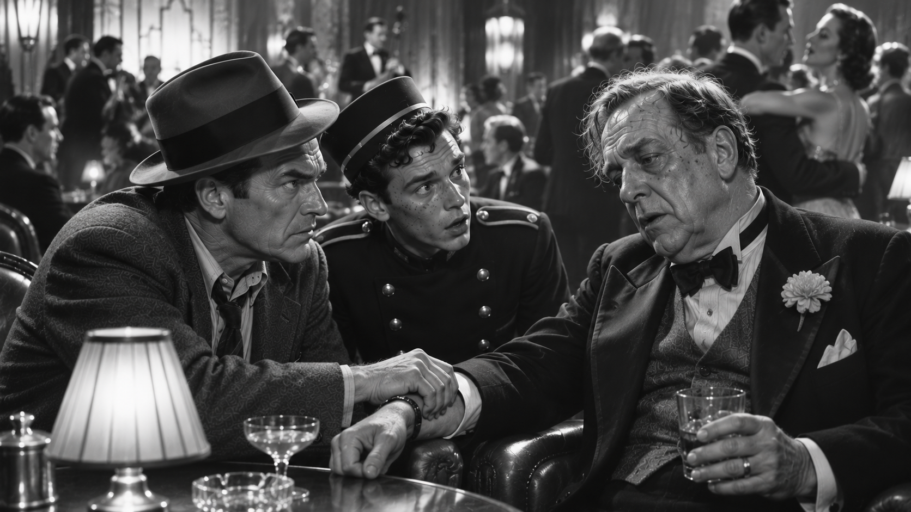

# Edward Berkman

As we approached the entrance to the lounge, I was quick to get the Montana girl away from us. “Listen, kid, if Berkman does turn out to be behind this, and not some alpha zombie controlled by Dr. Horrible there, it's probably best if we keep the dummy away from him. Why don't you take it and see if you can flush out some more of the staff coming off work and get them to the basement before they start eating the guests and spoiling all of tonights' fun?”

“Good idea, Mr. Chase,” she said and started off for the main elevators.

“Hey, and kid, I know you. Stick to the plan. Don't go looking for those Upper Weaver brats, and definitely don't let them see you with that thing. We still haven't figured out how all of this ties together, and we definitely don't need them knowing we've got the magic mastermind there.”

“Okay, Mr. Chase.”

“Alright, Reggie, let's go see what this guy knows. Whatever happens, follow my lead.”

“You got it, Mr. Chase.”

They entered the lounge area, where a dozen or so couple were still dancing to a five piece swing band that had set up in the corner. At least these musicians weren't zombies, even if the bartender and at least part of the wait staff were. I still hadn't figured out how nobody noticed that.

“That's him over there,” Reggie said, pointed to a late middle-aged man sitting alone at a corner table that bumped right up to the dance floor. He looked like a kid whose dog had just died as he slowly stirred a half-full drink on the table in front of him.

“Good evening, Mr. Berkman,” I said as Reggie and I took seats at the table across from him.

“I'm sorry, I'm in no mood to sign autographs right now,” he said into his drink. Seeing we were going to sit down regardless of his mood, he relented and seemed to brighten a little upon seeing Reggie. “Oh, Mr. O'Grady, I'm sorry, I didn't know it was you.”

“Alright, Berkman, spill it. What's you game here?”

“Game? What game are you talking about?”

I've been in this business long enough to know when people are lying to me, and usually even why thay are lying to me. Berkman was genuinely confused. I had to be careful about how much I gave away.

“You're not a student of the dark arts? Some kind of necromancer whose spell got away from him?” I decided he did look old. I took a chance and grabbed his wrist, looking for a pulse. To my surprise, there was one.

He recoiled in shock. “Dark arts? That's one that hasn't been leveled at a ventriloquist since the 16th century when the accused Joan of Ark of speaking in tongues.  No, sir, I assure you what I do is purely a matter of practice and skill.  There's nothing sinister involved.”

“And your ... dummy? ... familiar? ... wooden creepshow? I suppose you're going to tell me there's nothing special about him either?”

“Doctor Whipple? He comes from a well-to-do family and was top of his class at medical school. I met him after his second wife left him.”

A cold chill went up my spine. I instantly cringed. “Stop! Where did you get the dummy, Mr. Berkman.”

“Oh, the dummy? I made him.”

“You made him?!”

“He's just a head on a stick wrapped in some clothes. It's not that difficult. I couldn't go out on the circuit with a store-bought dummy at any rate.”

“He's not made from the wood of a sacred tree? You didn't cast any kind of incantations on him while you were sewing him into that suit?”

“Certainly not.”

“He doesn’t talk to you and give you secret missions or anything when you're not holding him?”

“No, of course not.” Berkman seemed to recoil a little. “Wait ... he ... didn't give you a secret mission ... did he?”

“What?! No! I'm just saying, I think Dr. Murmurs has been doing some very bad things when you're not around.”

Berkman put his hand on top of mine and patted it condescendingly. “Son, you realize it's all an act, right? Doctor Whipple is just a dummy ... a doll. He's not a real person. It's my voice making him talk. Okay?” His eyes suddenly went distant, and his lips stopped moving. “I just practiced really hard to the point I'm able to talk in a silly voice without moving my lips.”

Reggie started to applaud, but I shut him down with a glare. “Mr. Berkman,” he said, “do you have any idea why Mr. Whispers there would be able to command zombies?”

“Zombies?”

“Like the undead? Gray skin? Sunken eyes? Trouble standing upright? Walk really slow? Eat brains?”

Berkman gave the question more consideration than it deserved. “Well, no. He's never done anything like that before.”

“How can you build a dummy with your own two hands and not know it's gone off the reservation and started commanding the armies of the dead?!” I asked, losing my patience just a bit.

“I assure you if he has, it has nothing to do with me. He seemed perfectly normal at our show tonight. He seemed perfectly normal at our show tonight. In fact, he was on script the whole night. Dead letter perfect, you might say. We killed it. The crowd loved us. I even had one youmg lady ask me to stay behind, have a few drinks, and take her dancing. It turns out she was a huge ventriloquism fan in general, and a bigger fan of mine.”

“This happens a lot?”

“Well, some of the other guys on the circuit brag about it, but I’ve never ... no, I’m a gentleman. I run a clean show.”

Now we were getting somewhere. That story had “suspicious" written all over it in flashing neon. “Where is this lady now?”

“Oh, she excused herself and went off to bed. We're supposed to meet for a late lunch tomorrow, but in retrospect, I think I'm going to cancel.”

“Why is that?”

“Well, for one thing, discretion. She's far too young for me. It just doesn't look proper for a man my age to be seen as an object of affection to a girl her age. For another, I must admit, I think she was more taken the lifestyle than she was with me.”

I suppressed a grin. Hell, I suppressed a really good laugh, and I could have used a really good laugh right about then. “The lifestyle?”

“Yes, she was very much enamored with Doctor Whipple. Kept asking how he worked. Keep manhandling him. Kept asking me to make him say things for her. In the end, I gave him to Reggie here and had him sent to my room and put to bed. She seemed to lose interest in me at that point.”

At this point, Sally Montana peeked her head into the lounge from the kitchen area and made a gesture indicating she needed us to follow. I signaled for her to keep the dummy out of sight. Lest we alarm Berkman that his doll was up past its bedtime.

We said our goodnights and ran to join Sally in the back exit of the room, which led to the kitchen area and the service corridor beyond. “I found four more of those Zombie maids cleaning rooms. Doctor Whipple here got them down to the storage area downstairs,” she said, half out of breath. “The kitchen staff has gone home for the night. Just the two working this room. The bartender, well, we saw what happened to him. I think we’re good until morning.”

I raised a finger to silence her. “No, the zombie situation is mostly under control until morning. ‘We’ are most certainly not good. Nothing is good about this entire insane case! We still have to keep Carson from discovering any of this.”

“O’Grady!” A boisterous voice sounded from the other side of the room. Water commissioner Goldstien stood there, arm in arm with the Widow Henerbery on his arm. They both strode across the room to meet us. “I just wanted to tell you that my man located the source of that metallic taste in your water. It turns out the brine tank on your filtration system hadn’t been refilled in years. I’ve gone ahead and ordered everything you need and it should be here by morning. As for the mysterious glowing runoff, he went to investigate it a few hours ago, but that was the last I heard from him. I suppose he went home. It is rather late after all. I’ll check in with him in the morning and get you an update on what we’re going to be doing about that for you.”

“Gee, thank you, Mr. Goldstein. We really appreciate your dedication to civil responsibility and owe a great debt to you for all you’ve done for us.”

“Well, I trust you won’t forget and will DARE to do WELL, yourself. I’ll say hello to my nephew, Elroy for you.”

“Don’t worry Mr. Goldstein. I won’t forget. I really TREASURE our relationship.”

Goldstein gave Reggie a pat on the shoulder, let out his gutteral, animal laugh, and escorted the Widow Henerbery out to the main lobby.

“What the hell was that all about?” I asked.

“Oh, just a favor I’m doing for him on the side in exchange for checking out that glowy stuff in the alley.”

“Oh, right.” I nodded, then began processing. “Wait, did he say he a man looking into it, who he hasn’t heard back from yet?”

Reggie’s face went white. “Oh, no. You mean we might have another one wandering the grounds?!”

“We’ve got to find him before Carson does. I need you up front keeping Carson occupied. Do you know where that filtration system is?”

Reggie nodded. “Yeah, it’s in the machine room right next to the boiler. You can take the west stairwell down to get there. That passkey I gave you will let you in. If you follow me back to the front desk, I’ve got a big flashlight you can use.”

I turned to Sally. “Okay, take Dr. Spooky here and check it out -- from the doorway. If you see anything, go tell Reggie. This isn't going to be one of the friendly toilet-cleaning zombies. I’ll go check out the alleyway and loading dock area where the glowy goo is.”

“Good luck, Mr. Chase,” Reggie said as went our separate ways.
