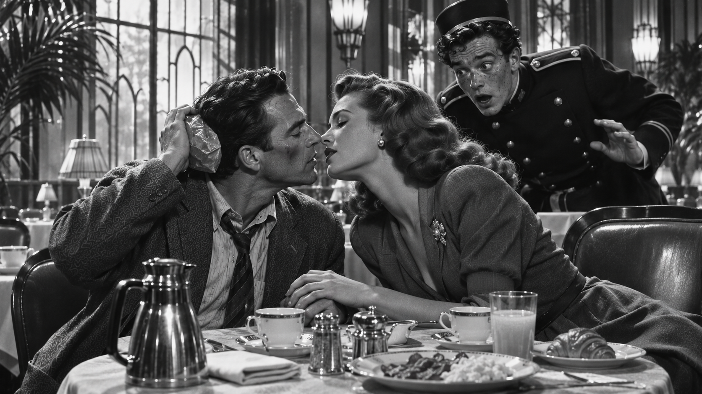

# The Breakfast Club

It stumbled into the hotel restaurant, having already stopped by the kitchen to pick up an ice pack.  I spotted Peyton Halston-Kensington sitting with Charles Montana, eating breakfast.

“Mmmm, coffee, yes, I’d love some,” I said as I stumbled up to them and collapsed in the fourth chair at their table.  They all sat up instantly in interest.

Charles immediately grabbed the empty cup and began pouring from the carafe. “My god, Mr. Chase. What the devil happened to you?”

“Pipe wrench, I suspect.  Memory’s a little foggy.  There was a thug with a machine gun, but he was worthless.”

“And this was all over the Green Destiny? The authorities should be notified immediately.”

“Now, don’t be hasty, Charles.  This is your daughter’s big day; we certainly don’t want a bunch of policemen crawling around the hotel making everyone nervous.”

“Yes, but if things have turned violent, then maybe your theory that someone is out to steal it does have some weight to it after all.”

“I’m pretty sure it wasn’t personal, Mr. Montana,” I said, still thinking of the $200 I would be out if I didn’t find that necklace in the next nine hours before he went to collect it from the safe. “If anything, it shows how desperate they are to get me out of the way so they can make their move.”

It was about this time that Weatherby wandered into the restaurant, obviously just arriving and making the morning rounds.  He caught sight of me and immediately made a beeline right for our table. I hastily started to get up.  The less talk of that necklace, the better, and Weatherby was the most likely of the four of us who knew it had already been stolen to slip up and let everyone know.

“Good morning, Mr. Chase, Mr. Montanna,” he suddenly perked up a bit, and an odd smile crept onto his face. “Miss Halston-Kensington.”  He was positively beaming.  Somehow, “friendly” looked completely alien on that face.  “I was wondering if you’d like to stop by my office this morning.  I’ve had a few inspirations about how we can make that ball of yours tonight a real spectacle, and something they will talk about for years to come.”

“Why thank you, Mr. Weatherby, but all of the arrangements have been set in stone by committee for months now.  Making last-minute changes on a whim so close to the event would take far too much discussion and coordination, and we’re all going to be far too busy setting everything up.”  She smiled cordially and went back to her breakfast.

Weatherby deflated. “I see. In that case, if you’d like to come by and inspect the list and quantity of staff I have scheduled to be at your disposal, let me know if I’m meeting all of your requirements.”

“Oh, Mr. Weatherby, I’m certain you know more about these types of events and what is required far better than I do.  I will completely trust your judgment in staffing requirements and am confient you’ve already met my every need.”

Weatherby suddenly looked like she had kicked his puppy.  “That may be so.  Well, I will be in my office all day if you find you … need anything.  Please don’t hesitate drop by, even if it’s just to say, ‘hello.’”

This time she didn’t even look up at him. “I certainly shall, Mr. Weatherby. Thank you so much for everything you’ve done.”

At that obvious dismissal, Weatherby quickly said his goodbyes to Charles and myself before hastily heading back to his office.

“What was that all about?” I asked.

Peyton busied herself looking for a waiter. “Oh, I am certain I have no idea. He seems to have gotten it into his head that I am more important than I am in the planning committee.”

Charles consulted his watch.  “And speaking of that, I have an important meeting with the other fathers I need to be changing for, if you two will excuse me.”  He stood up and made his way to the exit.

“Important meeting?” I asked. “He was already in business attire.”

“He meant to say, ‘tee time,’” Peyton offered.  “Now, Jack, are you sure you’re alright?”

“Yes, I’m fine.  It happens all the time.  Turns out my head is a lot harder than you would think.”

“Well, I have been thinking about it a lot.  This has gotten completely out of hand. These are no ordinary thieves. They could have killed you. I don’t want anything to happen to you. I simply couldn’t live with myself.  So, I’ve decided  I want you to stand down from the case.”

“Like hell.”

“You were right. There’s every reason to believe that the reason they’ve resorted to violence is desperation. Now, with Weatherby in his office all day, there is no way they can get to the necklace short of armed robbery. Nobody is foolish enough to attempt something like that.”

“I’m not stepping off until that ball goes off without a hitch.”

“I will consider this satisfactory completion of that goal and pay you the $200 right now.  That way, if they somehow do get the Green Destiny between now and the ball, you are off the hook.”

“Why are you doing this?”

“Don’t you see, Jack.  I … I’m starting to fall for you.  I can’t bear the thought of anything else happening to you.  I need you safe.  I don’t care about the jewels anymore.  I just want to be with you.” Tears welled up in her eyes, and I nearly took the money just to make her happy again.  I didn’t want to admit it, but I was starting to fall for her a bit too.  It’s an occupational hazzard that’s happened to me a half a dozen times before.  Obviously never quite working out as well as anyone had hoped, but I had to hit pay dirt eventually, right?

In the meantime, however, there was just one problem.  She was the client, and she had hired me for a case.  It’s bad business if you leave cases open, even if the dame does cry.  “Sorry, dollface. I never leave a case unfinished. You’re the client; I’m the hired hand. One way or the other, I’m seeing this through to the end. After that, well, maybe we can talk about … us … if there really is an us.”

She wiped her tears, put her hand on top of mine, and smiled. “Oh, I do hope so, darling.” We both leaned in, and I could already taste the hard candy from the bottom of the purse.  Unfortunately, fate had a different plan.

“Mr. Chase!  Mr. Chase!”

Reggie O’Grady had somehow appeared from nowhere right behind Peyton. His face looked panicked.  It somehow seemed wrong on him.  Nothing ever panicked the kid. It’s one of the things I liked about him.

“What’s wrong kid?”

“You really need to come see this!  I think it’s important!”

The kid had been solid about his observations up to this point, I had no reason to believe he was overreacting.  I managed to get to my feet, despite my head’s best efforts to accept Peyton’s offer to take the money and spend the next few days recovering in a spa somewhere.

He led me down the service corridor, gesturing for me to stay close to the wall. When we arrived at the loading dock, I saw one of the tong members holding the service elevator open.  He yelled at someone outside and made wild gestures with his hands.  I heard the engine of a large truck, no doubt, idling at the loading dock outside.

Suddenly, another tong member walked in from the dock, carrying a silver metallic tank of some sort.  He manhandled it into the elevator, left it and started back for the truck, just as two more of them, carrying a large wooden crate with Chinese writing on the side into the elevator.  Behind them, still another was carrying an array of pipes of some sort.

We watched for the next several minutes as the crew shuffled back and forth between the truck and elevator, moving metal tanks, pipes, crates, and the occasional bundle of wiring and electronics into the elevator.  When the car was full, the one holding the door stepped in, took it to the third floor, and returned with an empty car again a few minutes later.  Then the process started all over again with a seemingly endless supply of tanks and pipes being moved to the banquet hall.

“What do you think they’re doing, Mr. Chase?”

I stroked my beard and built a mental image of what kind of machine required multiple tanks, pipes, and electronics. None of the designs entering my head were particularly friendly.  “I don’t know kid, but it doesn’t look like any kind of fancy electronic wok I’ve ever seen.  I don’t like it.  The tong is definitely planning something. You should probably get in there and help speed things along.  If they should encounter a one of our musician friends or accidentally hit the wrong button and end up in the storage room--”

“I tried that,” Reggie interrupted. “None of them spoke English or understood what I was asking.”  He fished a key on a chain out of his shirt.  “I locked off everything except the ground floor and 3, however.  So, no worry about them bumping into anyone they shouldn’t, at least for now.”

“Good thinking.  I’ll poke around on three after the truck is gone and see if I can get an idea of what the hell they’re building.  That means I’m going to need you, Sally, and the talking cupie doll to find that homicidal plumber.”  I gingerly rubbed the back of my head. “Keep your distance, though. He’s got a mean backhand.”

Reggie went pale.  “Where is Sally?  I haven’t seen her since she went down to the basement last night.”

“What do you mean you haven’t seen her?  That should have been easy.  Open the door, shine the flashlight, realize the plumber isn’t down there, he’s bashing my skull in behind the building, report back to you.”

“Well, she didn’t.”

“You gotta show me where this boiler room is, kid.”

“Other side of the building.  This way.”  Reggie said almost sprinting for the lobby.
